# 📚 Online Reading App


Plataforma web full-stack para **publicar, descubrir y leer contenido escrito**, pensada para comunidades literarias. Los usuarios exploran un catálogo de libros, crean y siguen listas, califican, llevan su historial de lectura y leen capítulos en un lector configurable. Los autores publican sus obras en Markdown y los administradores moderan el contenido.

> Proyecto grupal realizado en la Universidad Nacional de Tucumán, luego adaptado para portfolio con Docker y despliegue en Render.

🔗 **Demo online:** https://booklist-frontend-snfs.onrender.com
> ⏳ El servidor está en el plan gratuito de Render y se suspende por inactividad. La primera visita puede tardar cerca de un minuto en responder.

<!-- 📸 CAPTURA 1: Home completa (carousel superior + sección "Popular") -->
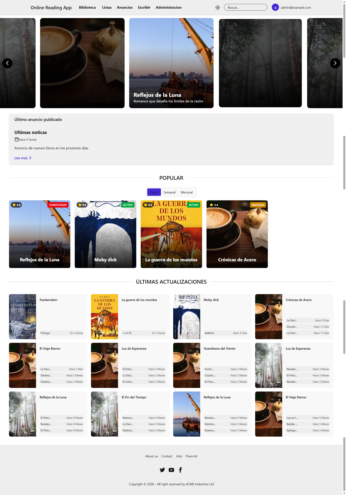

---

## 👤 Usuarios de ejemplo

Para probar la demo (y el entorno local con datos de ejemplo) podés ingresar con:

| Rol | Email | Contraseña | Qué podés probar |
|---|---|---|---|
| Administrador | `admin@example.com` | `Admin123!` | Panel de administración, moderación, usuarios, reportes |
| Autor | `autor1@example.com` | `Autor123!` | Dashboard del autor, crear libros, volúmenes y capítulos |
| Lector | `user1@example.com` | `User123!` | Catálogo, listas, calificaciones, historial |

> Son cuentas de demostración con datos ficticios.

---

## ✨ Funcionalidades

### Lectores
- Catálogo con **búsqueda** por título, autor o descripción, **filtros** por género y estado, y orden por popularidad.
- **Calificaciones** de libros.
- **Listas personalizadas** (públicas o privadas) y seguimiento de listas de otros usuarios. Límite de 20 listas por usuario y 100 libros por lista, sin duplicados.
- **Historial de lectura**, privado para cada usuario.
- **Reporte de contenido** inapropiado o con errores, con seguimiento de la respuesta del administrador.

<!-- 📸 CAPTURA 2: Catálogo con el buscador y los filtros aplicados -->
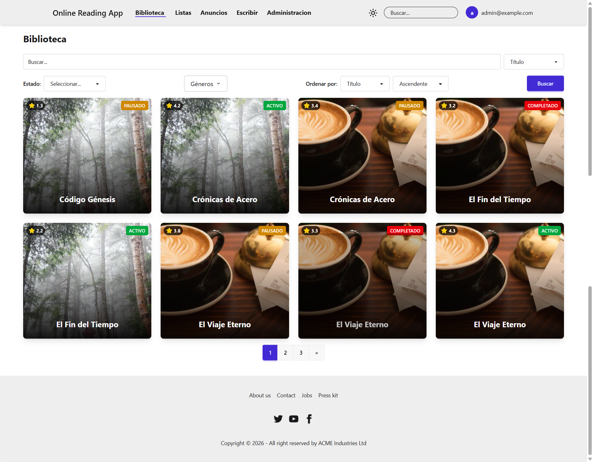

<!-- 📸 CAPTURA 3: Detalle de un libro (volúmenes, capítulos, calificación, botón de agregar a lista) -->
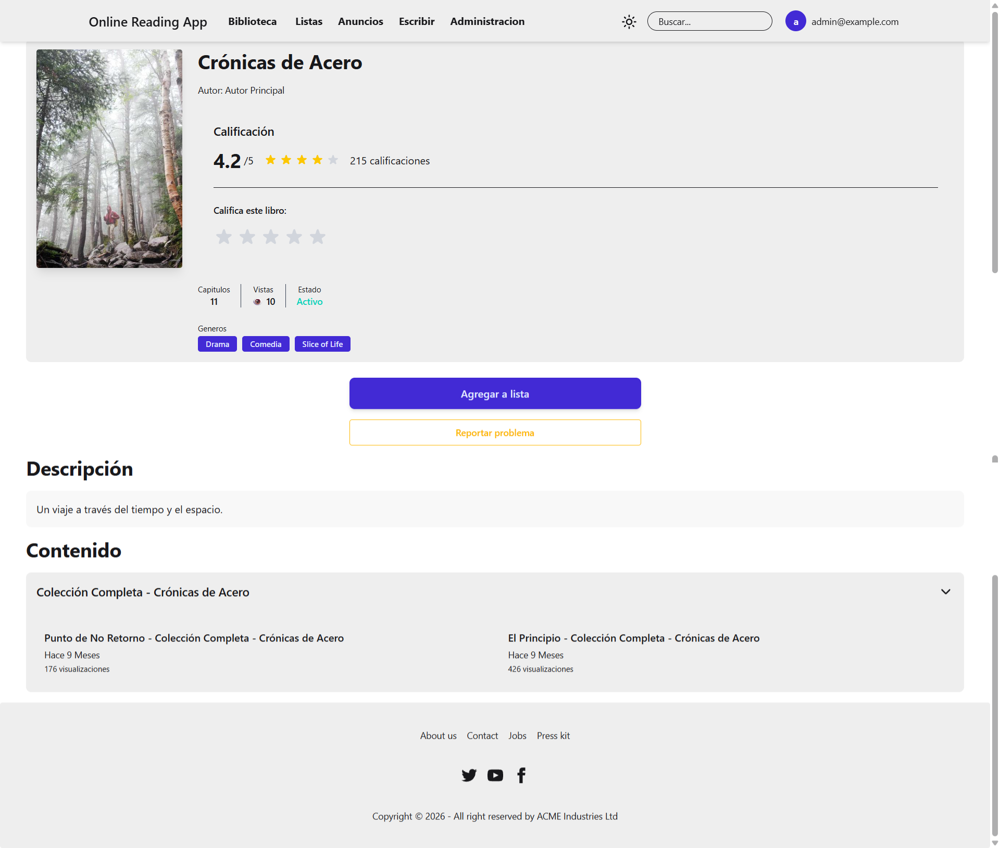

<!-- 📸 CAPTURA 4: Página "Mis listas" o el detalle de una lista -->
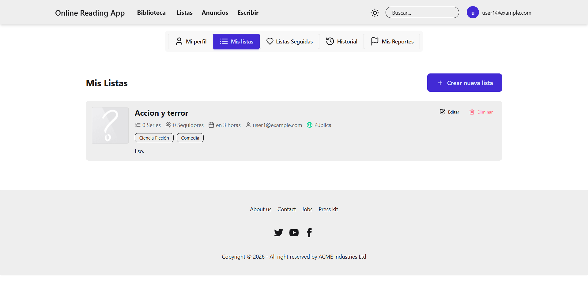

### Lector de capítulos
- Contenido renderizado desde **Markdown**.
- Fuente, tamaño de texto e interlineado configurables, modo de **alto contraste** y **pantalla completa**.
- Navegación entre capítulos anterior y siguiente.

<!-- 📸 CAPTURA 5: Lector con el panel de ajustes abierto (ideal: una con alto contraste activado) -->
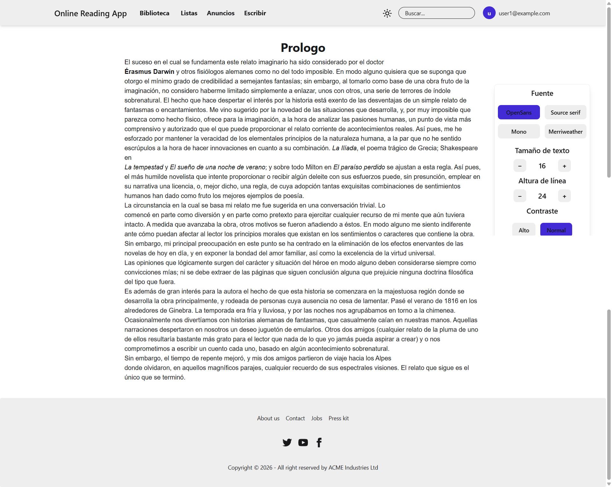

### Autores
- Dashboard con estadísticas de sus obras.
- Creación y edición de **libros, volúmenes y capítulos** con editor Markdown.
- Flujo de **solicitud de publicación** con estados: pendiente, aprobada, rechazada o con cambios solicitados.

<!-- 📸 CAPTURA 6: Dashboard del autor -->
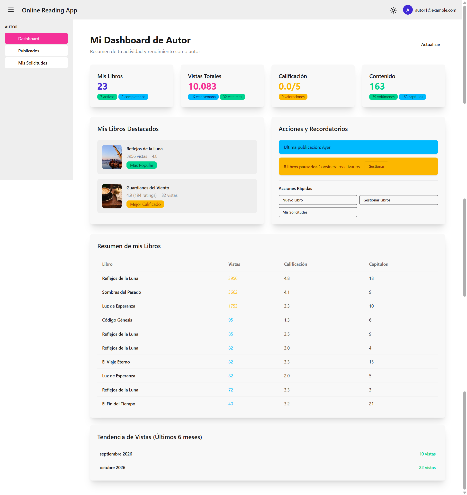

<!-- 📸 CAPTURA 7: Formulario de creación de libro o editor de capítulo -->
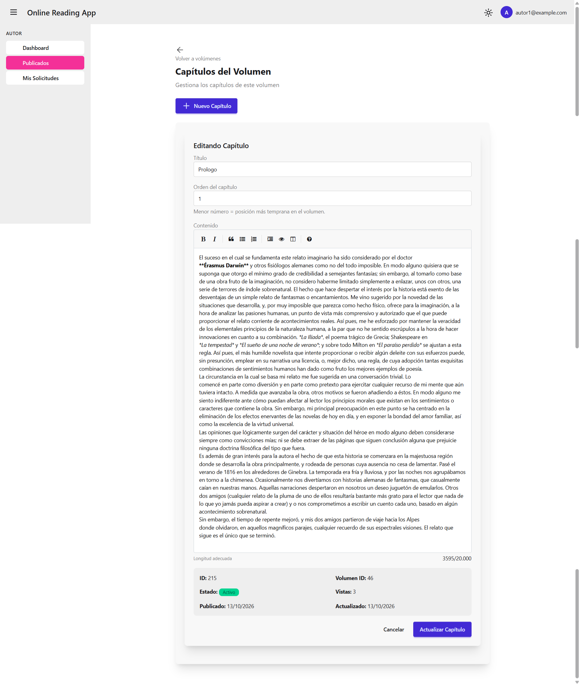

### Administradores
- Dashboard con métricas y acciones pendientes.
- **Aprobación o rechazo** de solicitudes de publicación, con comentarios.
- **Gestión de usuarios:** listado paginado, cambio de roles, bloqueo y desbloqueo.
- Gestión de géneros, anuncios y **resolución de reportes**.

<!-- 📸 CAPTURA 8: Dashboard del administrador -->
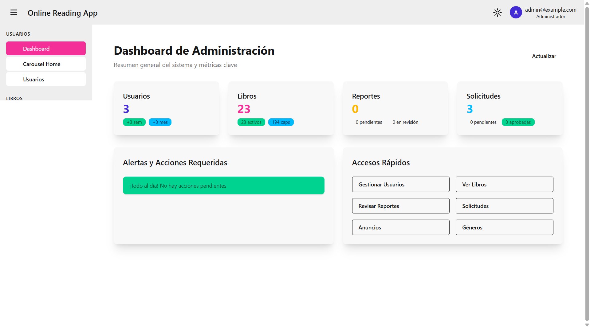

<!-- 📸 CAPTURA 9: Gestión de usuarios o de solicitudes pendientes -->
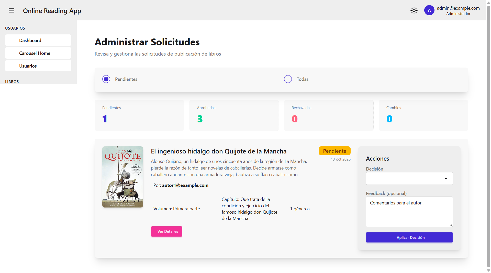

### Diseño responsive
Interfaz adaptada a escritorio, tablet y móvil.

<!-- 📸 CAPTURA 10: Vista móvil (home o lector, tamaño de celular desde las DevTools) -->
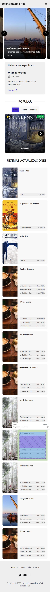

---

## 🛠️ Tecnologías

| Capa | Tecnologías |
|---|---|
| **Frontend** | Angular 19 (standalone components, signals, `rxResource`), TypeScript, Tailwind CSS, DaisyUI, Swiper, Lucide Angular, ngx-markdown |
| **Backend** | ASP.NET Core 9 (API REST), Entity Framework Core 9, ASP.NET Core Identity, JWT Bearer, AutoMapper, Swagger / OpenAPI |
| **Base de datos** | PostgreSQL 16 (Npgsql) con migraciones de EF Core |
| **Servicios externos** | Cloudinary (imágenes) |
| **DevOps** | Docker (multi-stage), Docker Compose, nginx, Render |

> 💡 El proyecto original se desarrolló con SQL Server. Se migró a **PostgreSQL** para poder desplegarlo en Render.

---

## 🏗️ Arquitectura

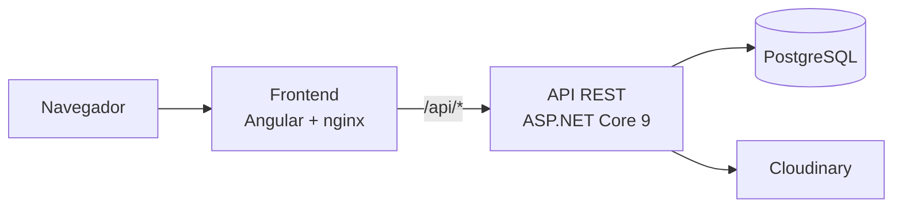

- **Frontend:** SPA en Angular servida por nginx, que además actúa como *reverse proxy* de `/api` hacia el backend (evita problemas de CORS).
- **Backend:** arquitectura en capas: controladores, lógica de negocio, repositorios con `DbContext` y DTOs mapeados con AutoMapper.
- **Seguridad:** autenticación con JWT, autorización por roles (usuario, autor, administrador), guards de rutas en Angular y un middleware que bloquea a los usuarios suspendidos.
- **Datos iniciales:** al arrancar, el backend aplica las migraciones y, si se habilita, carga datos de ejemplo (usuarios, géneros, libros, capítulos e historial de lectura).

<!-- 📸 IMAGEN 11: Diagrama de base de datos (está en la página 28 del PDF de la facultad) -->
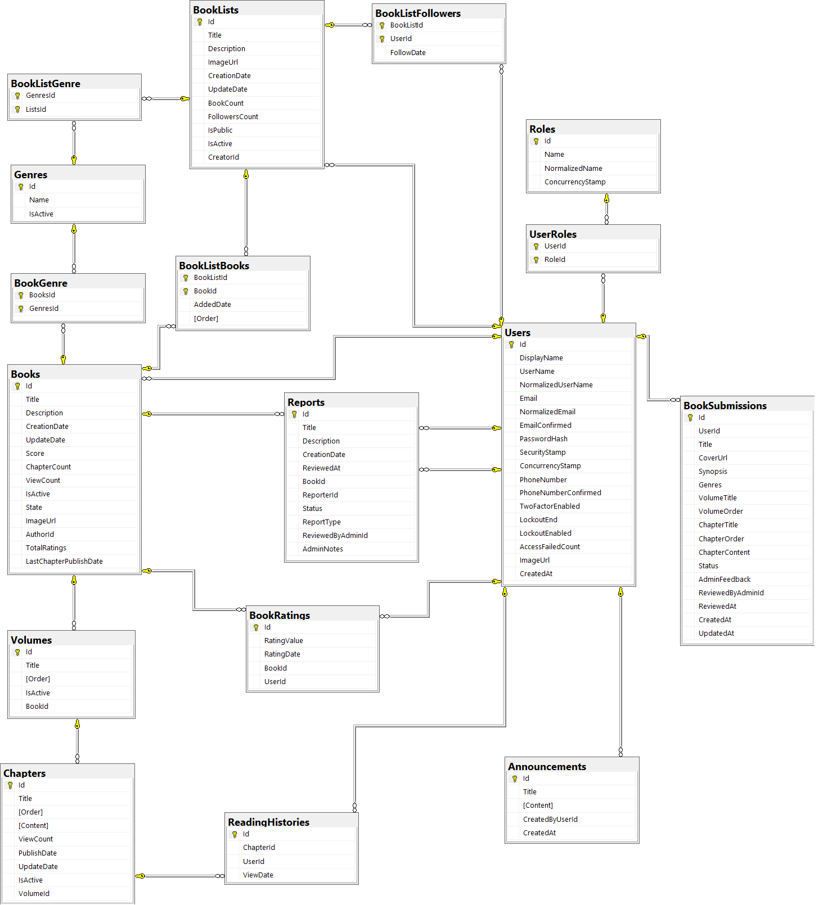

### Estructura del repositorio

```
.
├── backend/              # API ASP.NET Core 9
├── frontend/             # Aplicación Angular 19 (+ nginx.conf)
└── docker-compose.yml    # PostgreSQL + API + Frontend
```

---

## 🐳 Levantar el proyecto con Docker

La forma más simple: no necesitás instalar .NET, Node ni PostgreSQL.

**Requisito:** [Docker Desktop](https://www.docker.com/products/docker-desktop/) en ejecución.

```bash
git clone <url-del-repositorio>
cd <nombre-del-repositorio>
docker compose up --build
```

La primera vez tarda unos minutos (descarga de imágenes, `npm install` y compilación). Al arrancar, la API **aplica las migraciones y carga los datos de ejemplo** automáticamente.

| Servicio | URL |
|---|---|
| Frontend | http://localhost |
| API | http://localhost:8080 |
| Swagger (documentación de la API) | http://localhost:8080/swagger |
| PostgreSQL | `localhost:5432` |


### Comandos útiles

```bash
docker compose up -d --build   # levantar en segundo plano
docker compose logs -f backend # ver los logs de la API
docker compose down            # apagar (conserva los datos)
docker compose down -v         # apagar y borrar la base de datos
```

> ⚠️ `docker compose up` **no reconstruye** las imágenes. Si cambiás código, usá `--build`.

### Variables de entorno del backend

| Variable | Descripción |
|---|---|
| `ConnectionStrings__DefaultConnection` | Cadena de conexión a PostgreSQL (formato Npgsql) |
| `DOCKER_ENV` | `true` aplica las migraciones al iniciar |
| `SEED_DATA` | `true` carga los datos de ejemplo si la base está vacía |
| `ApiSettings__SecretKey` | Clave para firmar los JWT (mínimo 32 caracteres) |
| `Cloudinary__CloudName`, `Cloudinary__ApiKey`, `Cloudinary__ApiSecret` | Credenciales de Cloudinary para subir imágenes |

Si no están definidas en `appsettings.json`, pasalas como variables de entorno. No subas credenciales reales al repositorio.

---

## 💻 Desarrollo sin Docker

**Requisitos:** .NET 9 SDK, Node.js 22 (o 20.11+), PostgreSQL y Angular CLI 19.

```bash
# Backend
cd backend
dotnet restore
# Configurá ConnectionStrings:DefaultConnection, ApiSettings:SecretKey y Cloudinary
# en appsettings.Development.json
dotnet ef database update
dotnet run

# Frontend (otra terminal)
cd frontend
npm install
npx ng serve
```

Ajustá la URL de la API en la configuración del frontend para que apunte a tu backend local. La aplicación queda en http://localhost:4200.

---

## ☁️ Despliegue en Render

Se despliega como tres servicios independientes:

1. **PostgreSQL** (base de datos administrada).
2. **Backend:** web service con Docker, desde `backend/`. Configurar las variables de entorno de la tabla anterior.
3. **Frontend:** web service con Docker, desde `frontend/`. Su nginx redirige `/api` al backend por HTTPS.

---

## ✅ Pruebas

El proyecto cuenta con más de 50 casos de **prueba manual documentados**, que cubren acceso y roles, solicitudes de publicación, lectura, listas, administración, búsqueda y filtros.

---

## 🚀 Posibles mejoras

- Tests automatizados (xUnit en el backend, Jasmine/Jest en el frontend).
- Integración continua con GitHub Actions.
- Búsqueda insensible a tildes (extensión `unaccent` de PostgreSQL).
- Validación automática del contenido subido.